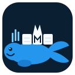

<p align="center">
  
</p>

<h1 align="center">mihomo-sub</h1>

<p align="center">
  A one-container Mihomo gateway for a NAS or home router: convert subscriptions, refresh them on a schedule, expose a web dashboard, and optionally serve converted profiles to other devices on your LAN.
</p>

<p align="center">
  <a href="README.md">简体中文</a>
</p>

[](https://github.com/pure-white-ice-cream/mihomo-sub/actions/workflows/docker-publish.yml)
[](VERSION)
[](https://hub.docker.com/r/purewhiteicecream/mihomo-sub)
[](LICENSE)

The release version is [`VERSION`](VERSION). Images are published to Docker Hub and GHCR:

- `purewhiteicecream/mihomo-sub`
- `ghcr.io/pure-white-ice-cream/mihomo-sub`

## Who this is for

**For:** people who already have a subscription URL and want one container on a NAS, a home router, or a Linux box. LAN clients use the mixed port; phones can import the converted profile from the same host.

**Not for:** a public subscription site or public converter; publishing 7890/9090/25500 on the internet; redistributing someone else's nodes.

## Features

- Mihomo + Subconverter + Zashboard
- Scheduled updates, with the last good config kept on failure
- Multiple subscriptions in `sub_url` (separate with `|`)
- `overlay.yaml` for DNS / rules / TUN that survive refreshes
- Dashboard API secret (generated on first boot if unset)
- Optional LAN subscription endpoint (clash / surge / quanx / sing-box)
- `linux/amd64` `linux/arm64` `linux/arm/v7` `linux/386`

## Quick start

```bash
cp .env.example .env
# edit .env and set at least sub_url
docker compose up -d
```

Or:

```bash
docker run -d \
  --name mihomo-sub \
  -e TZ=Asia/Shanghai \
  -e sub_url="https://your-subscription-url.com" \
  -e cron="0 4 * * *" \
  -p 7890:7890 \
  -p 9090:9090 \
  -v mihomo-data:/root/.config/mihomo \
  purewhiteicecream/mihomo-sub:latest
```

If Docker Hub is slow, pull from GHCR:

```bash
docker pull ghcr.io/pure-white-ice-cream/mihomo-sub:latest
```

1Panel / CasaOS / Portainer can import [`deploy/portainer-stack.yml`](deploy/portainer-stack.yml).

## After it starts

1. Read the container logs for the **API secret** and **subscription token** (generated once, then stored on the volume).
2. Open `http://<host-ip>:9090/ui` and enter the same secret.
3. Point HTTP/SOCKS clients at `<host-ip>:7890`.
4. Do not publish 7890, 9090, or 25500 to the public internet.

Refresh the subscription at most about once a day. Hourly updates are a common way to get the upstream account banned.

## Environment variables

| Variable | Meaning | Default |
| --- | --- | --- |
| `TZ` | Timezone | `Asia/Shanghai` |
| `sub_url` | Subscription URL(s), `|`-separated, **required** | none |
| `config_url` | External Subconverter template | none |
| `cron` | Schedule; `off` disables the timer | `0 4 * * *` |
| `SECRET` | Dashboard / Clash API secret | random |
| `ALLOW_LAN` | Allow LAN access to the proxy port | `true` |
| `MIXED_PORT` | Mixed port | `7890` |
| `CONTROLLER_PORT` | Dashboard port | `9090` |
| `NOTIFY_WEBHOOK` | POST `{"status","message"}` on failure | none |
| `SUB_TOKEN` | Token for LAN converted profiles | random |
| `SUB_UA` | User-Agent used to fetch subscriptions | `clash.meta` |

## overlay.yaml

Each refresh rewrites `config.yaml`. Put durable DNS, TUN, and extra rules in `overlay.yaml` on the volume. See [`examples/overlay.yaml`](examples/overlay.yaml). Managed keys (`mixed-port`, `secret`, `external-controller`) always come from environment variables.

## LAN converted profiles

Publish port 25500 on the LAN only, then import (replace the token from the logs):

```
http://<host-ip>:25500/getprofile?name=profiles/clash.ini&token=<SUB_TOKEN>
```

Targets: `clash.ini`, `surge.ini`, `quanx.ini`, `singbox.ini`. Use Tailscale or similar for remote access.

## TUN

For a home router that should take over all traffic, enable `tun` in `overlay.yaml` and start:

```bash
docker compose -f docker-compose.tun.yml up -d
```

This uses host networking, `NET_ADMIN`, and `/dev/net/tun`. Misconfiguration can take the host offline.

## License

[MIT License](LICENSE). The mark in `assets/logo.svg` is original geometry and does not copy Docker or MetaCubeX trademark artwork.
